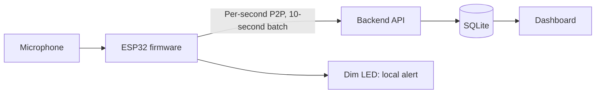

# Planned architecture

## Responsibilities

- **Firmware:** sampling, P2P calculation, 30-second threshold tracking, LED control, packet sequencing, and retries where possible.
- **Backend:** contract ingestion and validation, deduplication, data storage, missing-sample detection, and query services.
- **Dashboard:** presentation of the latest status, history, events, and reports; it must not present P2P as dB SPL.
- **SQLite:** storage for telemetry and derived data needed within the initial scope.

## Data flow and alerts

Firmware calculates a P2P value for each second, groups 10 samples into a telemetry packet, then sends it to the API. The backend identifies packets uniquely by device identity, boot instance, and packet sequence. Firmware tracks a continuous 30-second threshold exceedance to activate the LED; threshold rules, brightness, and server-side events are **TODO: confirm**.

When connectivity is lost, the device must retain enough information for later retransmission; buffer capacity, backfill strategy, and time synchronization are not yet finalized.
